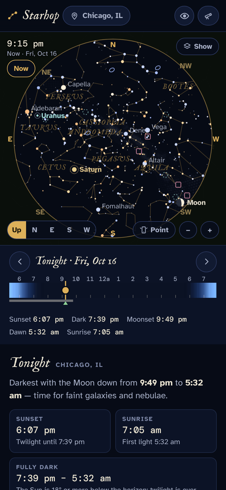
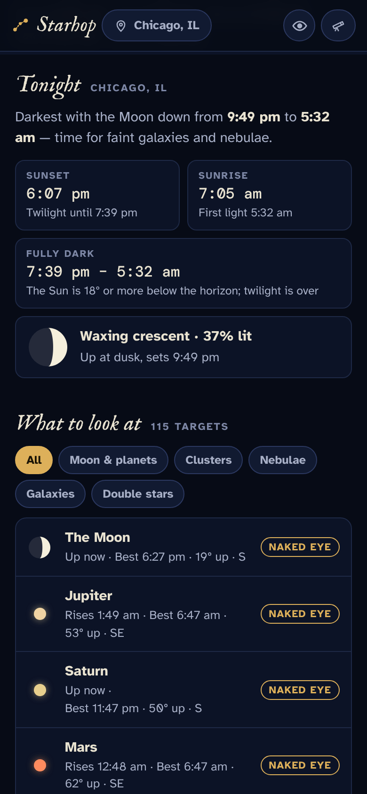
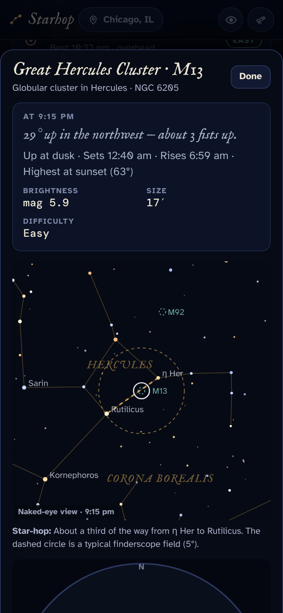

# Starhop

**Use it: [starhop.junkdrawer.works](https://starhop.junkdrawer.works/)**

**What's up tonight from where you are, what's worth pointing a telescope at, and how to find it by hopping from stars you know.** Set where you observe and the telescope or binoculars you have, and Starhop draws tonight's sky as it looks from there, says when it's properly dark and lists what's worth a look. Tap anything for where to find it: a finder chart with a star-hop from bright stars, and how it will look in your eyepieces. It installs as an app (from the browser's menu, or Share → Add to Home Screen on an iPhone) and works offline once it has loaded.

<p align="center">
  
  &nbsp;
  
  &nbsp;
  
</p>

## What it does

- **Sky map.** Tonight's sky for your location and time: stars down to about magnitude 6 (and Mira, the variable star in Cetus, as it looks near its brightest), constellation lines and names, the Milky Way, the planets and the Moon (with its phase), plus clusters, nebulae and galaxies.
  - Drag to look around and pinch or scroll to zoom.
  - **Up** shows the whole dome overhead, laid out like a planisphere you hold above your head; **N / E / S / W** face a direction.
  - **Show** turns constellation lines, names, deep-sky objects, the Milky Way and an altitude grid on or off.
  - It shows only what the sky allows: twilight, the Moon and how dark your sky is all change which stars appear. Clusters, nebulae and galaxies follow the sky too: they fade as twilight or moonlight makes them harder in your telescope, and come out once the Sun is 6° down.
- **Night timeline.** Sunset to sunrise, shaded through civil, nautical and astronomical twilight, with a band for when the Moon is up. Drag along it (or use the arrow keys) to see the sky at any hour, or step to other nights. Changing place keeps the night you're planning.
  - By day it shows tonight's sky once it's dark. Left open, it follows the clock from the start of the night and moves on to the next night in the morning.
- **Tonight.** Sunset, when the sky is fully dark, sunrise, the Moon's phase and hours, and a verdict: a dark night for faint galaxies, or a moonlit one for planets, doubles and clusters.
- **What to look at.** The Moon and planets, then the best-placed deep-sky objects and double stars, ranked for your telescope and your sky. Each shows the best time to look and where, and on tonight's list whether it's up now, rises later or has set. In the evening what's up before midnight comes first, then what rises after it, and a row for something that has set for the night is dimmed.
  - **Not seen yet** leaves out what you've marked as seen, and a line under the list counts what you've seen, with how many of the 110 Messier objects, and opens your log.
  - On summer nights that never get properly dark, deep-sky objects and doubles are timed for when the Sun is at least 6° down; when it never gets that far, only the Moon and the brightest planets are listed.
- **Object cards:**
  - **Where to look:** altitude in fists at arm's length, compass direction, and rise, set and highest times.
  - **Finder chart:** a naked-eye view around the target, the finder you set under Telescope (a 5° finderscope circle, a small 6×30 finder's 7°, a Telrad's rings of 4°, 2° and ½°, or nothing for a red dot), and a star-hop, e.g. "about a third of the way from η Her to Tianji, 2.5° from η Her" for M13.
  - **Your telescope:** magnification and field for each eyepiece (and again with your Barlow, if you set one), which one to use, and a sketch of the eyepiece view. The sketch is turned to match the finder chart and the way your telescope shows the sky, which you set under Telescope: upside down in a reflector or Dobsonian, mirrored left to right with a star diagonal, or as the sky; N and E mark north and east. It draws the other clusters, nebulae and galaxies that share the field, labelled (M32 and M110 beside the Andromeda Galaxy), fades each as its Difficulty says, and the advice names them ("M82 shares the 25 mm field"). Tap another eyepiece to see its view.
  - **Binoculars:** choose them under Telescope (7×50, 10×50, 15×70 or your own power and field) and the card gives their one power and field instead of the eyepiece table, the sketch shows their whole field the right way round, and the finder chart's circle is their field.
  - **Planets:** Jupiter's four moons in their positions for that time, Saturn's rings at their current tilt, and the phases of Venus and Mercury.
- **Your log.** **Mark as seen** on a card (anything but the Moon) puts it in your log, under the night you saw it (a mark at 1 am goes under the evening before; one made while looking back at an earlier night, under that night). Each entry keeps the time, where you were, your telescope or binoculars and the power the eyepiece sketch showed, and you can add a note and rate the seeing (how steady the stars are) and the transparency (how clear the air is) from 1, poor, to 5, excellent. A second tap on the button takes that night's entry out again; the card also lists the other nights you saw it.
  - **Open your log**, under the list or on a card, lists every entry newest first, to open and edit, with **Copy as text** and **Download CSV**.
  - The CSV has a header row and a row for each entry, with these columns: Object, Night of, Date, Time, UTC offset, Place, Latitude, Longitude, Seeing (1-5), Transparency (1-5), Instrument, Aperture (mm), Power, Eyepiece, Description. They cover what the Astronomical League's [Messier Program](https://www.astroleague.org/?p=8432) asks observers to record (its Rule 1: date and time, latitude and longitude, seeing and transparency, aperture, power and a description). The League counts only objects you find yourself, not with a phone app.
- **Coming up.** Moon phases, meteor shower peaks, planet oppositions and elongations, the Moon passing bright planets, and eclipses, as seen from your location. Tap one to step to its night.
  - A shower is listed for the night it peaks, with the hours its radiant is up and whether the Moon is in the way then. Showers whose radiant never gets well above your horizon are left out.
  - Mercury and Venus say how high they are at dusk or dawn, a planet at opposition how high it gets, and the Moon passing a planet is given for a time you can see it, when the Sun is down and the Moon up.
- **Point at the sky** (phones, on the website). Tap **Point** and the map fills the screen and follows where the back of your phone points. **Stop**, or Back, returns to the page.
  - Phone compasses are rough, and a metal telescope nearby makes them worse. If the map doesn't match the sky, drag it onto a star you recognize; the phone remembers the correction. While one is in force it shows beside **Stop**, with **Reset** to clear it, since it suits only where you held the phone when you made it.
  - The screen stays on while you point.
  - Inside claude.ai the page can't read the phone's sensors, so pointing only works on the website.
- **Use my location** in the location sheet, also on the website; elsewhere, search for a town or enter coordinates.
- **Night vision.** Everything turns dim red so your eyes stay dark-adapted at the eyepiece.
- **Remembered in the browser:** your location, telescope or binoculars (with the telescope's eyepieces, Barlow, finder and which way round it shows the sky), sky, your log, night vision, what the map shows and your compass correction.

## How it works

- **Positions.** The Sun, Moon and planets come from [Astronomy Engine](https://github.com/cosinekitty/astronomy) (MIT), version 2.1.19, kept in `js/` so it works offline. The same library supplies rise and set times, twilight, moon phases, Jupiter's moons, Saturn's ring tilt, elongations, oppositions and eclipses.
  - Stars and deep-sky objects are J2000 catalog positions, turned to altitude and azimuth with its rotation matrices.
- **Fonts.** Atkinson Hyperlegible, DM Mono and IM Fell English (SIL Open Font License) are in `fonts/`, served from here so nothing loads from elsewhere.
- **Map projection.** Stereographic, the projection planispheres use. It keeps constellation shapes true, and the horizon is always a circle, which makes the ground easy to draw.
- **Time zones.** Every time is shown in the observing location's own time zone, whatever the device is set to.
- **Difficulty ratings are a rule of thumb:**
  - **Galaxies and nebulae:** the object's surface brightness is compared with the sky's, helped by aperture and penalized by moonlight and twilight. For big objects the rating uses the bright core, which is what you see first.
  - **Double stars:** rated by the power needed to split them, against your telescope's resolving limit and the highest power your eyepieces reach (with a Barlow, up to the telescope's highest useful power, twice its aperture in millimetres); a pair that needs no more than 0.6 of that highest power, and is at least twice as wide as the telescope can resolve, is an easy split. The power is a rule of thumb, not a published formula: about 240 ÷ the separation in arcseconds, and a quarter more again for each magnitude the companion is fainter than the primary beyond the first, since a faint companion is lost in the glare. Binoculars go by the same rule at their one power. Epsilon Lyrae's card also says whether your eyepieces split each of its two stars again.
- **Star-hops.** A hop starts at a star you can see from your sky (named or lettered, down to magnitude 4.5), no more than 8° from the target, a few finderscope fields. From there it heads toward a second star with the target on the way ("0.8° from Sheliak, toward Sulafat" for the Ring Nebula), or goes through a second star and on ("from Mirach through μ And and about as far again" for the Andromeda Galaxy), preferring short hops from bright stars, close to the line. When no pair of stars works, it gives the distance from the nearest star you can see, which can be more than 8° away (from a city sky, often). The stars are ones that are up at the time the finder chart shows, and outside the object itself, so a cluster's hop doesn't start from one of its own stars. The chart labels them and widens, up to 60°, to take them in, and draws the stars too faint to see by eye from your sky as hollow dots, since a finder still shows them. The brightest stars, brighter than magnitude 1.5, need no hop, and nor does a double star you can see plainly from your sky (its star a magnitude brighter than the faintest you see), which is the star at the centre of the chart. A cluster, nebula or galaxy you can see without a telescope from your sky says so, and keeps its hop.

## Running it

It's a static site: one HTML page plus a few data files, with no build step and no server code. Host the folder anywhere static, or serve it from here:

```sh
python3 -m http.server        # then open http://localhost:8000
npm test                      # uses the page in Chromium through Playwright, with the place and date pinned so the sky is the same every run
npm install                   # once, for the PNG encoder the screenshots use (upng-js)
node tools/screenshots.mjs    # redraws docs/*.png and og.png
node tools/make-icons.mjs     # redraws the PNG icons from icon.svg
python3 tools/build_data.py   # rebuilds data/; the steps to fetch its sources are at the top of the script
```

Opening `index.html` straight from disk won't work, because browsers block reading the data files that way. Pointing at the sky and **Use my location** need a secure address: https, or localhost.

To put it online with GitHub Pages: **Settings → Pages → Build and deployment → Deploy from a branch**, then pick `main` and `/ (root)`. The `CNAME` file gives it its own address.

### Files

- `index.html`: the whole app: the sky map, the night's timeline, tonight's summary, the targets and their ratings, the object cards with their finder charts, star-hops and eyepiece views, and the telescope and location sheets. Your settings are kept in the browser's localStorage.
- `js/astronomy.browser.min.js`: [Astronomy Engine](https://github.com/cosinekitty/astronomy) 2.1.19 (MIT), served from here.
- `data/`: the stars, constellations, deep-sky objects, Milky Way and cities, built by `tools/build_data.py`. [data/SOURCES.md](data/SOURCES.md) has their licenses.
- `fonts/`: Atkinson Hyperlegible, DM Mono and IM Fell English (SIL Open Font License), served from here so nothing loads from elsewhere.
- `sw.js`: keeps the page, the library, the data files and the fonts for using offline, and opens from them when the network doesn't answer within a few seconds.
- `carry.js`: brings your settings over from Starhop's old address, junkdrawer.works/starhop, the first time it opens here.
- `manifest.webmanifest`, `icon.svg` and the `icon-*.png` icons let it install; `og.png` is the link preview.
- `tools/`: `build_data.py` and `wgsn.tsv` for the data, `screenshots.mjs`, and `make-icons.mjs` with `icon-full-bleed.svg`.
- `test/e2e.mjs`: the test, which drives the real page in Chromium.

## Data

`data/` holds compact files built by `tools/build_data.py` from:
- [d3-celestial](https://github.com/ofrohn/d3-celestial) 0.7.35 (BSD-3-Clause), which provides:
  - the Hipparcos-based star catalog and star names;
  - IAU constellation lines;
  - the Milky Way outline, resampled here into a grid of soft glows;
  - the positions and types of the Messier objects and other deep-sky objects.
- The [SEDS Messier Catalog](http://www.messier.seds.org/data.html) by Hartmut Frommert and Christine Kronberg: the visual magnitudes and sizes of the Messier objects, used with acknowledgement for non-profit, educational use.
- [NGC 2000.0](https://cdsarc.cds.unistra.fr/viz-bin/cat/VII/118) (ed. Sinnott, 1988), through VizieR: the sizes and magnitudes of the NGC showpieces added in November 2026, such as the Jewel Box and the great southern globular clusters.
- [OpenNGC](https://github.com/mattiaverga/OpenNGC) by Mattia Verga (CC BY-SA 4.0), the open-cluster catalogues of Dias et al. (2002) and Kharchenko et al. (2009) through VizieR: a few numbers NGC 2000.0 and d3-celestial lack, for the Needle Galaxy, the Tarantula and Turtle nebulae and Stock 2.
- The [Washington Double Star Catalog](http://www.astro.gsu.edu/wds/) (U.S. Naval Observatory): the double stars' separations, position angles and magnitudes. This research has made use of the Washington Double Star Catalog maintained at the U.S. Naval Observatory.
- [city-timezones](https://github.com/kevinroberts/city-timezones) 1.3.4 (MIT): 7,300 cities with their time zones.
- The [IAU Catalog of Star Names](https://exopla.net/star-names/modern-iau-star-names/) (public domain), kept in `tools/wgsn.tsv`: a star d3-celestial names goes by the name the IAU gives it (ζ Her is Tianji, not Rutilicus), and one whose name the IAU never adopted goes by its Bayer or Flamsteed label (ν Oph).

The double-star notes and object descriptions were written for Starhop. The steps to rebuild are at the top of the build script, and [data/SOURCES.md](data/SOURCES.md) has the licenses.

## License

MIT — see [LICENSE](LICENSE). The data in `data/` keeps its sources' licenses, listed in [data/SOURCES.md](data/SOURCES.md), and the fonts in `fonts/` keep the SIL Open Font License.
